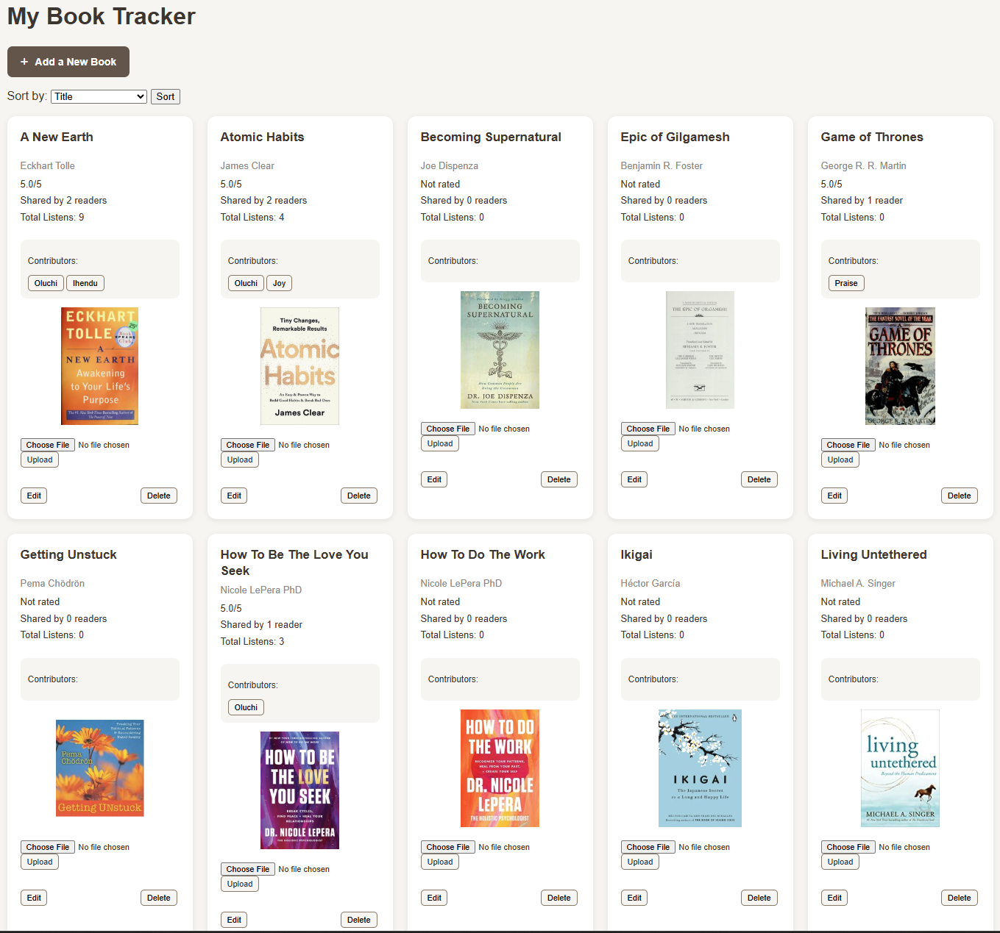
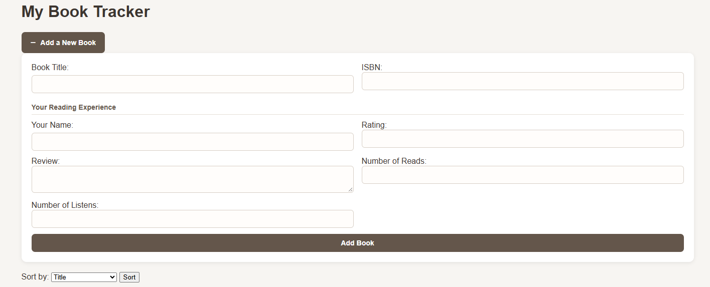
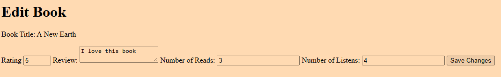

# 📚 Community Book Tracker

## Project Description

Community Book Tracker is a web application designed to provide a shared digital bookshelf where readers can discover, contribute to and keep track of books and reading experiences.

Unlike a traditional personal reading tracker, the application brings readers together around a shared collection. Users can add books, record their personal reading experiences, and contribute ratings, reviews, and reading or listening activity.

The application integrates with the Open Library API to retrieve book information using an ISBN or book title. Users can also manually add books when they cannot be found through the search functionality.

**Live Application:** [Community Book Tracker](https://book-tracker-fikm.onrender.com)

## Features

- Search for books using an ISBN or book title.
- Retrieve available book information, including titles, authors and cover images, through the Open Library API.
- Manually add books when they cannot be found through the API.
- Upload custom book cover images.
- Maintain a shared community book collection.
- Contribute personal ratings and reviews to books in the collection.
- Track individual reading and listening activity.
- View community contributors associated with each book.
- Explore individual readers' experiences through an interactive reader-experience modal.
- View a contributor's rating, review, number of reads and number of listens.
- Edit personal ratings, reviews, reading counts and listening counts.
- Delete books from the collection.
- Sort books by title, rating, publication year, number of reads and number of listens.
- Store book information and reader contributions in a PostgreSQL database.

## Technologies Used

- **Node.js:** JavaScript runtime used to run the server.
- **Express.js:** Web framework used to handle application routes and server requests.
- **PostgreSQL:** Relational database used to store book information and reader contributions.
- **pg (node-postgres):** Connects the Node.js application to PostgreSQL.
- **EJS:** Templating engine used to generate dynamic HTML pages.
- **Axios:** HTTP client used to retrieve book information from the Open Library API.
- **Multer:** Middleware used to handle custom book cover image uploads.
- **dotenv:** Loads environment variables from the `.env` file.
- **HTML:** Provides the structure of the web pages.
- **CSS:** Styles the application and provides responsive layouts.
- **JavaScript:** Handles application logic and interactive frontend functionality.

## Application Screenshots

### 1. Home Page

Displays the shared book collection, including book covers, titles, authors, reading activity, community contributions and book management options.



### 2. Add a New Book

Allows users to add books using the Open Library search functionality or enter book information manually, with optional personal reading details.



### 3. Edit Book

Allows users to update their personal ratings, reviews, number of reads and number of listens.



## Project Structure

```text
Book-tracker/
├── public/
│   ├── styles.css
│   ├── script.js
│   └── uploads/
├── views/
│   ├── index.ejs
│   └── edit.ejs
├── Screenshots/
│   ├── home-page.png
│   ├── add-book.png
│   └── edit-book.png
├── index.js
├── package.json
├── package-lock.json
├── .gitignore
└── README.md
```

### File and Folder Description

- `index.js`: Main application file containing the Express server, routes and database operations.
- `package.json`: Contains project dependencies and scripts.
- `package-lock.json`: Records installed dependency versions.
- `.gitignore`: Specifies files and folders Git should ignore.
- `public/`: Contains static frontend assets.
- `public/styles.css`: Contains the application's styling.
- `public/script.js`: Handles interactive frontend functionality, including the reader-experience modal.
- `public/uploads/`: Stores uploaded book cover images locally.
- `views/`: Contains EJS templates.
- `views/index.ejs`: Main page for adding and displaying books.
- `views/edit.ejs`: Page for editing personal book information.
- `Screenshots/`: Contains screenshots of the application.

## Installation and Setup

### Prerequisites

Make sure you have the following installed:

- [Node.js](https://nodejs.org/)
- [PostgreSQL](https://www.postgresql.org/)
- npm (included with Node.js)

### 1. Clone the repository

```bash
git clone https://github.com/oluchiejikam-cmyk/Book_tracker.git
cd Book_tracker
```

### 2. Install dependencies

```bash
npm install
```

### 3. Set up the environment variables

Create a `.env` file in the project root directory.

For local development, configure your PostgreSQL password:

```env
DB_PASSWORD=your_postgresql_password
```

Do not upload your `.env` file or share your database credentials publicly.

### 4. Set up the database

Open PostgreSQL using pgAdmin and create a database named:

```sql
CREATE DATABASE "Book_Tracker";
```

Connect to the new database and create the required tables using the project's database schema.

### 5. Start the application

```bash
npm start
```

Open your browser and visit:

```text
http://localhost:3000
```

The application uses the configured `PORT` environment variable when available.

## Open Library API Integration

Community Book Tracker integrates with the Open Library API to retrieve available book information.

Users can search for books using an ISBN or book title. The application uses Axios to send HTTP requests and retrieve available book details, including titles, authors and cover information.

If a book cannot be found through the API, users can manually enter the book details and upload a custom cover image.

API documentation:

- [Open Library Search API](https://openlibrary.org/dev/docs/api/search)
- [Open Library Covers API](https://openlibrary.org/dev/docs/api/covers)

## Database

The application uses PostgreSQL to store book information and reader contributions.

Book information includes:

- Book title
- ISBN
- Author
- Publication year
- Book cover

Reader contribution information includes:

- Reader name
- Rating
- Review
- Number of reads
- Number of listens

The database stores the information used to display the shared collection and individual reader experiences.

## Future Improvements

- Introduce user authentication and individual reader accounts.
- Allow users to maintain personal book collections.
- Improve input validation and error handling.
- Add automated tests.

## Author

**Oluchi Ejikam**

Community Book Tracker was developed as a full-stack development project to practise backend development, database management, API integration and frontend development while exploring how technology can support shared reading experiences and community engagement.